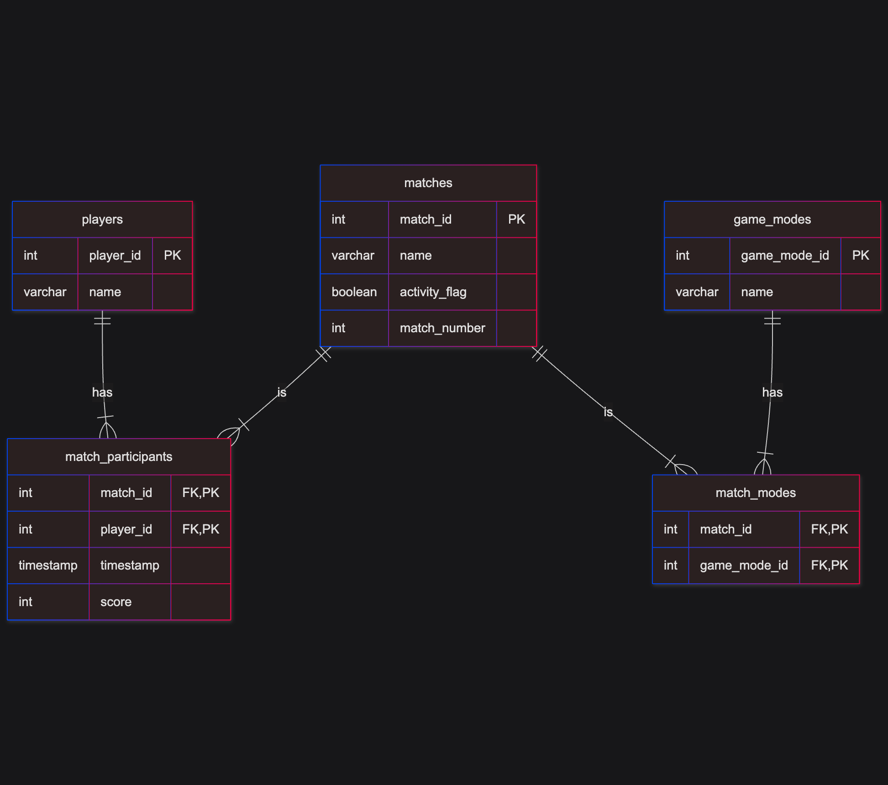

# EX603 Game Telemetry Database

This file describes the model of an online gaming platform telemetrics system.

## The Domain

The online gaming platform telemetrics system answers the following types questions:

Basic questions:
1. How many players are in the system?
2. How many matches are in the system?
3. How many players are in each match and who are they?
4. When did a player join a match and what is their current or final score?
5. What game modes is a match using?

Advanced questions:
1. What is the average score of a player?
2. What are the top scores (leaderboard) within a match?
3. What are the top scores (leaderboard) across all matches?
4. Which matches have the most players?
5. What are the score trends over time?
6. What are the match participation rates over time?

## Database Overview

The system schema and sample data was provided by the instructor. The data can
be found in the gaming.sql provided to the class.

The main entities in the system include:
* Players (actors)
* Matches (producers)
* Game modes (catalog)
* Match participants (events)

The relationship between these entities include a many-to-many relationship
between matches and players where multiple players can be in a match and players
can play multiple matches, and a many-to-many relationship between matches and
game modes where matches can have multiple game modes.

### Schema

The schema consists of five main tables:
1. `game_modes` (catalog role), a lookup table defining the different possible
   game modes. Each of the game modes has a non-null unique name to prevent
   confusion when configuring a match. This table has an ID as surrogate key for
   consistency and potentially performance.
2. `players` (actor role), describes a player who is using the online gaming
   platform. Each of the players has a non-null unique name to prevent confusion
   while playing a match. Because names are configured by platform users, they
   are restricted to alphanumeric characters and underscore. This table has an
   ID as surrogate key for performance.
3. `matches` (producer role), describes the match which is the producer of
   events. Matches have a non-null name that does not need to be unique, but
   because names are configured by platform users, they are restricted to
   alphanumeric characters and underscore. Matches have a boolean activity flag
   indicating if the match is in progress or not. Matches also have a match
   number to assist with filtering and sorting.
4. `match_modes` (junction role), a junction table connecting matches to game
   modes. Provides a many-to-many link between matches (producer) and game modes
   (catalog). Uses a composite primary key consisting of the match and game mode
   IDs which are also foreign keys.
5. `match_participants` (event role), a junction table connecting matches to
   player. Provides a many-to-many link between matches (producer) and players
   (actor). Captures the match events including a timestamp of the event and
   player score. Uses a composite primary key consisting of the match and player
   IDs which are also foreign keys.

### Entity Relationship Diagram



## Query Catalogue

### [Unit 3 Task 1](queries/unit3/q3_1.sql)

* 3.1.1 Find top 10 matches with high player counts.

* 3.1.2 Find all possible match participation statuses.

* 3.1.3a Filter match participants by score.

* 3.1.3b Filter match participants by disconnect reason.

* 3.1.4 Query 1 Find matches with a specific code.

* 3.1.4 Query 2 Find match participants and readable disconnect reason.

* 3.1.5 Categorize match performance as high, medium, or low.

### [Unit 3 Task 2](queries/unit3/q3_2.sql)

* 3.2a Query 1: Find count of match participants that did not have a network timeout (incorrectly using inequality on nullable column).

* 3.2a Query 2: Find count of match participants that did have a network timeout.

* 3.2a Repaired query: Find count of match participants that did not have a network timeout (correctly accounting for nulls)

* 3.2b Broken Query: Find disconnect reason for match and player (incorrectly using alias in WHERE).

* 3.2b Fixed Query 1: Find disconnect reason for match and player (repeating expression in WHERE).

* 3.2b Fixed Query 2: Find participation status for match and player (using CTE).

### [Unit 3 Task 3](queries/unit3/q3_3.sql)

* 3.3.1 Find names of players who had network timeouts (using subquery with WHERE IN).

* 3.3.2 Find names of players who had network timeouts (using CTE).

* 3.3.3 Find names of players who had network timeouts (set based approach).

### [Unit 4 Task 1](queries/unit4/q4_1.sql)

* 4.1.1 Find metrics on match scores including count, total, average, minimum and
maximum, and number of distinct players. Don't include scores where the player
didn't finish because their recorded score will be 0 affecting the average.

* 4.1.2 Find number of participants and average score for each match, sorted from
most participants to least.

* 4.1.3 Filter query 4.1.2 to matches with at least 10 players.

* 4.1.4 Find number of participants and average score for each match and region.

### [Unit 4 Task 2](queries/unit4/q4_2.sql)

* 4.2A Find number of participants and number of failures for each match.

* 4.2B Find subtotals and grand totals of number of participants and number of
failures for each region.

* 4.2C Find matches with a number of participants greater than average.

### [Unit 5 Task 1](queries/unit5/q5_1.sql)

* 5.1.1 Find the date, label, and names of players in each match.

* 5.1.2 Find the game mode and label of each match.

* 5.1.3 Find the players and who they were recruited by if anyone.

### [Unit 5 Task 2](queries/unit5/q5_2.sql)

* 5.2A Find unique matches using LEFT JOIN.

* 5.2A Find unique matches with participants using INNER JOIN.

* 5.2A Find matches without participants.

* 5.2B Find unique matches using RIGHT JOIN.

* 5.2B Find matches using FULL OUTER JOIN.

* 5.2C Find matches without participants using NOT EXISTS.

* 5.2C Find matches without participants using EXCEPT.

### [Unit 5 Task 3](queries/unit5/q5_3.sql)

* 5.3A CROSS JOIN two small tables.

* 5.3A Count rows in game_modes.

* 5.3A Count rows in players.

* 5.3A Count rows in cartesian product of games_modes and players.

* 5.3B Use EXPLAIN to examine query execution plan.

### [Unit 6 Task 1](queries/unit6/q6_1.sql)

* 6.1.1 Query 1 Find each players's score with the average score for its match.

* 6.1.1 Query 2 GROUP BY returns one row per match, not one row per player.

* 6.1.2 Rank matches by event count.

* 6.1.3 Split matches into four bands.

### [Unit 6 Task 2](queries/unit6/q6_2.sql)

* 6.2A Show score trends for one match (match_id 6).

* 6.2B Track daily total score and its seven-event-day moving average for 2023 Q4.

* 6.2C Find long gaps between adjacent events for matches.

### [Unit 6 Task 3](queries/unit6/q6_3.sql)

* 6.3A Find the top three players by score for each match.

* 6.3B Compare each calendar month's average player score with the prior month.

## Technical Highlights

- Inner and outer joins were used to connect matches, participants, and player
  details. LEFT JOIN, NOT EXISTS, and EXCEPT distinguish matches with
  players from those without them.
- Aggregations and grouping using GROUP BY, HAVING, and ROLLUP summarize scores
  and failures by match or region, filter groups by participant count, and
  include subtotals and grand totals.
- CTEs make intermediate results easier to reason about, improve readability of
  queries, and help with execution ordering.
- Window functions for rankings and trends like RANK, LAG, LEAD, and running or
  moving aggregates compare rows within a match or over time without collapsing
  the underlying events.

## Findings and Recommendations

Using the queries from unit 4, the data shows that the failure rate overall
across the platform is 27/200 or 13.5%. The matches with the highest failure
rates included matches 9 (28.6%), 2 (25%), and 11 (25%). When calculated across
regions the failure rate varied from 7.5% to 22.5%. The highest rates were found
in SA (22.5%) and NA (18.4%). The recommendation is to further investigate the
three specified matches and reach out to the participants involved.
Additionally, looking at the SA and NA region's platform infrastructure to
understand why failure rates are higher there would be recommended.

Using the queries from unit 6, the average score was 15.26 in January, dropped
to 12.36 in March, peaked at 25.54 in September, and ended at 16.95 in December.
It is therefore volatile, with a modest increase from the first to last month
but no sustained upward or downward trend. For next quarter, the recommendation
would be to continue reporting the monthly average score and investigate sharp
monthly swings before changing score balance. Break the trend down by match and
player to determine whether changes reflect scoring or a different mix of
events. The queries in task 1 shows each player with their match average.

## Limitations and Future Improvements

The provided data seemed unrealistic, but it might be my unfamiliarity with
online game telemetry. Some matches seemed to carry on for months. I don't think
that is a data quality issue of the model so much as an artifact of the
randomized mock data provided for analysis. I would be interesting to have data
from a real system and many more rows. It is difficult to know if the queries I
wrote would scale well to millions of rows.

## Video Presentation

_No video is included._

## How to Run it

To create and load the database:
```
% createdb ex603_data
% psql -d ex603_data -f gaming.sql
```
To execute a query, use a database visualizer such as DataGrip and open the
query files found in `query` folder.

## History

| Week |   Date    | Changes                                  |
| ---- | --------- | ---------------------------------------- |
| 3    | 2026OCT07 | Added Unit 3 queries and analysis.       |
| 4    | 2026OCT24 | Added Unit 4 queries and analysis.       |
| 5    | 2026NOV08 | Added Unit 5 queries and analysis.       |
| 6    | 2026NOV22 | Added Unit 6 queries and analysis.       |
